# Riset Konten Instagram — November 2026

Sumber: 12 link Instagram. Data diambil pada 21–22 November 2026 dari caption, jumlah like/komentar, dan thumbnail (frame pertama).

> **Catatan keterbatasan:** Video reel tidak bisa ditonton atau didengar. Analisis video hanya berdasarkan caption dan thumbnail. Bagian yang merupakan dugaan ditandai *(dugaan)*.

## Ringkasan cepat

| # | Akun | Format | Engagement | Topik |
|---|---|---|---|---|
| 1 | @loopraidn | Reel (iklan) | 4,7K like · 1,2K komentar | Jualan tools AI YouTube automation |
| 2 | @iq0670 | Reel | **3 jt like** · 20K komentar | Kumpulan chat ojol lucu |
| 3 | @miesoobek | Reel | 524K like · 5,5K komentar | Konten brand mie, tema truk/peta |
| 4 | @miesoobek | Reel | 308K like · 2,6K komentar | Drama chat "TOLONG!" |
| 5 | @iq0670 | Reel | 63K like · 540 komentar | Chat ojol part 4 |
| 6 | @miesoobek | Reel | 110K like · 768 komentar | Produk mie, "Bukan untuk ditiru" |
| 7 | @abiarts02 | Reel | 2,7K komentar | Gambar pensil lucu |
| 8 | @miesoobek | Reel | 130K like · 560 komentar | Meme "HUDANG!" (Bahasa Sunda) |
| 9 | @karinoen | Reel | 2,6K like · 108 komentar | Konten AI (bayi kembar) + ChatGPT |
| 10 | @king_min_su | Reel | **2 jt like** · 7K komentar | Ngemil jam 3 pagi |
| 11 | @rumpi_gosip | Foto | 16K like · 1,5K komentar | Plot twist screenshot chat anti-filter spam |
| 12 | @aldogiustino | Reel | 68K like · 559 komentar | Balas komentar: "capek ketipu mulu" (sindiran) |

---

## 1. Loopra — "Tukang ojol vs n8n"
https://www.instagram.com/p/DemxEmNAduT/ · @loopraidn · 17 Okt 2026

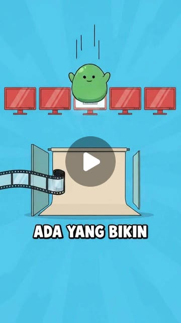

**Judul/topik:** Iklan produk Loopra, tools AI untuk YouTube automation tanpa coding.

**Ringkasan:** Storytelling perbandingan dua driver ojol yang membeli tools YouTube automation di hari yang sama. Yang pakai n8n bingung dengan node-node yang rumit dan belum jadi satu video pun. Yang pakai Loopra cukup menempel 1 link video viral AS dari HP, lalu 5 sistem AI mengerjakan sisanya. Thumbnail berupa animasi kartun hijau lucu dengan teks "ADA YANG BIKIN".

**Poin penting:**
- Hook relatable: sosok ojol, waktu luang hanya saat menunggu order, tidak bisa coding.
- Struktur problem–solution: kompetitor (n8n) diposisikan rumit, produk diposisikan simpel.
- Daftar fitur pakai emoji: riset viral, recreate 1 link → 5+ video, karakter konsisten, voice AI bahasa Inggris, auto-post multi-platform, bisa dari HP.
- Penawaran: harga coret Rp299K → Rp199K, bayar sekali, garansi 7 hari.
- CTA ganda: tombol "Get Offer" atau komen "MAU" (mendongkrak komentar, terbukti 1.197 komentar).
- Ada disclaimer "bukan jaminan penghasilan".

**Ide yang bisa diterapkan:**
- Gunakan format "2 orang, situasi sama, hasil beda" untuk menjual produk atau jasa.
- Pakai CTA "komen KATA" untuk mengumpulkan lead dan menaikkan engagement.
- Selalu sertakan disclaimer pada klaim penghasilan.
- ⚠️ Kritis: model "recreate video viral" berisiko melanggar kebijakan YouTube soal *reused content*. Pelajari teknik copywriting-nya, jangan langsung ikut model bisnisnya.

## 2. "Kumpulan chat ojol" — @iq0670 (balleee06)
https://www.instagram.com/reel/DeUPR0rSsir/ · 10 Okt 2026

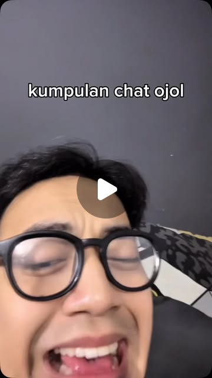

**Judul/topik:** Kompilasi chat lucu antara driver ojol dan pelanggan.

**Ringkasan:** Kreator merekam wajahnya sendiri dengan ekspresi heboh dan teks "kumpulan chat ojol". *(dugaan)* Isinya membacakan atau menampilkan screenshot chat ojol yang absurd. Caption hanya "surikiti 😭😭✨", tetapi meraih **3 juta like**.

**Poin penting:**
- Format sangat murah: wajah + screenshot, tanpa produksi.
- Topik super relatable untuk audiens Indonesia (ojol).
- Caption minimal; daya tariknya ada di ekspresi wajah dan teks hook di layar.
- Berpotensi dijadikan seri (lihat #5, part 4).

**Ide yang bisa diterapkan:**
- Buat seri "kumpulan chat [profesi/situasi]": chat customer olshop, chat dosen, chat grup keluarga.
- Ajak follower mengirim screenshot sehingga konten berasal dari audiens (UGC).
- Pasang teks hook besar di 1 detik pertama.

## 3. Mie Soobek — "Kak.. 😭"
https://www.instagram.com/reel/DejktvFSFkn/ · 16 Okt 2026

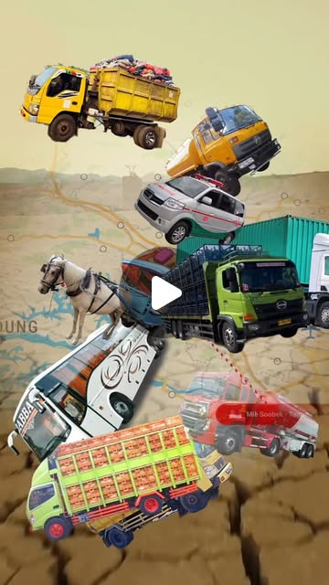

**Judul/topik:** Konten brand kuliner (BiangMie Bandung) dengan gaya meme/edit.

**Ringkasan:** Thumbnail berisi kolase kendaraan (truk sampah, truk Hino, bus, ambulans, delman, truk tangki) di atas peta Bandung. *(dugaan)* Ini meme tentang perjalanan atau "segala cara untuk sampai ke Mie Soobek", atau kisah pesanan yang melewati banyak kendaraan. 524K like.

**Poin penting:**
- Brand F&B yang tidak menjual secara langsung; mereka membuat konten hiburan/meme.
- Caption pendek dan emosional ("Kak.. 😭") memancing rasa penasaran.
- Visual absurd dan ramai membuat orang berhenti scroll.

**Ide yang bisa diterapkan:**
- Brand lokal bisa tumbuh lewat konten meme, tidak harus foto produk.
- Gunakan konteks lokal (peta kota, bahasa daerah) untuk kedekatan emosional.

## 4. Mie Soobek — "Kupluk.."
https://www.instagram.com/reel/DeWafs-y1td/ · 11 Okt 2026

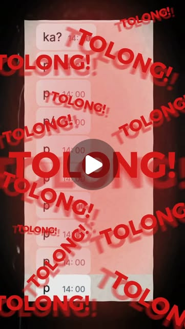

**Judul/topik:** Drama chat pelanggan.

**Ringkasan:** Thumbnail berupa screenshot chat berisi "ka?" lalu "p p p p p" berulang (spam ping) dengan tulisan "TOLONG!" merah di seluruh layar. *(dugaan)* Ini cerita lucu tentang pelanggan yang spam chat atau dramatisasi admin yang kewalahan. 308K like.

**Poin penting:**
- Mengangkat "penderitaan admin olshop/F&B", yang relatable bagi pelaku usaha dan pelanggan.
- Efek teks berulang yang dramatis menjadi hook visual yang kuat.

**Ide yang bisa diterapkan:**
- Ubah pengalaman customer service menjadi konten humor, dengan menyamarkan data pelanggan.
- Seri "curhat admin" untuk humanisasi brand.

## 5. "Kumpulan chat ojol part 4" — @iq0670
https://www.instagram.com/reel/DfW9CiNyU4_/ · 5 Nov 2026

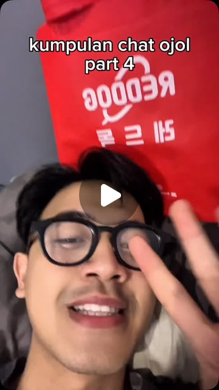

**Judul/topik:** Lanjutan seri #2.

**Ringkasan:** Format sama (wajah + teks "kumpulan chat ojol part 4"). Engagement turun jauh: 63K like vs 3 juta di part awal.

**Poin penting:**
- Seri membangun ekspektasi, tetapi engagement cenderung menurun pada part lanjutan.
- Satu video meledak biasanya karena isi chat tertentu, bukan formatnya saja.

**Ide yang bisa diterapkan:**
- Saat membuat seri, simpan materi terkuat dan variasikan hook per episode.
- Ukur performa per part; hentikan atau ubah format kalau jenuh.

## 6. Mie Soobek — "Bukan untuk ditiru ✋🏼"
https://www.instagram.com/reel/Df1zqsRSCo3/ · 17 Nov 2026

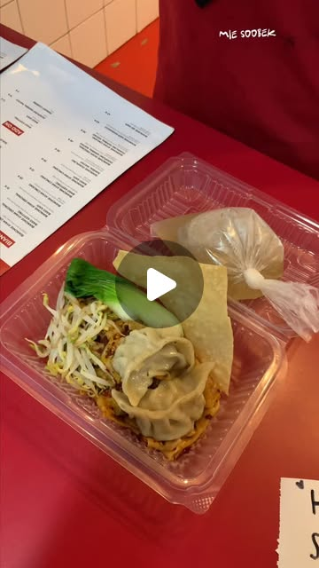

**Judul/topik:** Konten produk dengan bumbu humor/kontroversi kecil.

**Ringkasan:** Thumbnail menampilkan mie dalam kemasan take-away (pangsit, sayur, kerupuk, kuah terpisah) di meja toko dengan menu. *(dugaan)* Isinya cara makan atau trik "nyeleneh" terhadap produk. Caption "bukan untuk ditiru" memancing rasa penasaran. 110K like.

**Poin penting:**
- Produk tetap tampil, tetapi dibungkus narasi.
- Frasa "bukan untuk ditiru" adalah hook klasik pemicu rasa penasaran.

**Ide yang bisa diterapkan:**
- Selipkan produk di tengah cerita, bukan sebagai iklan.
- Uji caption "teaser" pendek vs caption deskriptif.

## 7. Abi Arts — "Boom saka laka boom"
https://www.instagram.com/reel/DemLacYBlqx/ · 17 Okt 2026

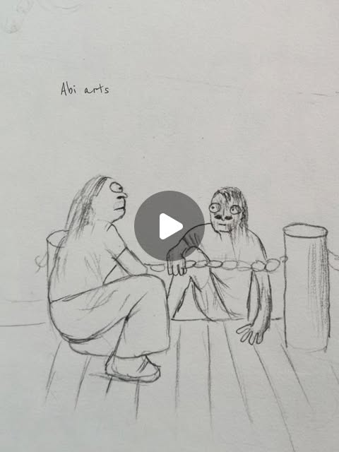

**Judul/topik:** Gambar pensil lucu (funny drawing).

**Ringkasan:** Sketsa pensil dua karakter aneh bergaya karikatur yang duduk di dermaga dengan tali rantai. *(dugaan)* Ini proses menggambar sambil diiringi audio/lagu viral "Boom shakalaka". 2,7K komentar.

**Poin penting:**
- Gabungan skill (menggambar) + audio tren + humor.
- Gaya gambar sengaja jelek-lucu sehingga mudah viral dan dikomentari.
- Watermark nama ("Abi arts") di dalam karya.

**Ide yang bisa diterapkan:**
- Pasangkan skill apa pun dengan audio trending.
- Taruh watermark/branding di dalam konten agar tetap terlacak saat di-repost.

## 8. Mie Soobek — "Lain kali lebih teliti ya 🙏🏼"
https://www.instagram.com/reel/De6j8_syxpm/ · 25 Okt 2026

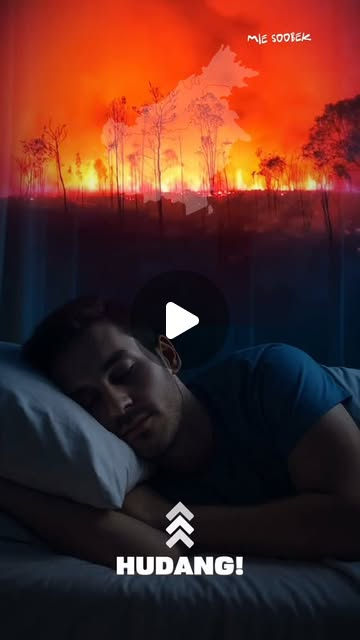

**Judul/topik:** Meme berbahasa Sunda.

**Ringkasan:** Thumbnail berupa pria tidur dengan latar kebakaran hutan dan peta, plus teks "HUDANG!" (bangun! dalam Bahasa Sunda) dan logo Mie Soobek. *(dugaan)* Ini meme tentang orang yang tidak sadar situasi gawat, dikaitkan dengan isu atau kejadian tertentu. 130K like.

**Poin penting:**
- Bahasa daerah (Sunda) memperkuat identitas lokal Bandung.
- Brand konsisten memakai logo kecil di setiap konten.
- Caption bernada sindiran halus.

**Ide yang bisa diterapkan:**
- Pakai bahasa daerah target pasar sebagai pembeda.
- Ikuti isu atau tren terkini dengan cepat, tetapi hati-hati dengan topik bencana yang sensitif.

## 9. Karinoen — "Capek.. Suka suka ChatGPT aja"
https://www.instagram.com/reel/DeyHt7CBKMk/ · 21 Okt 2026

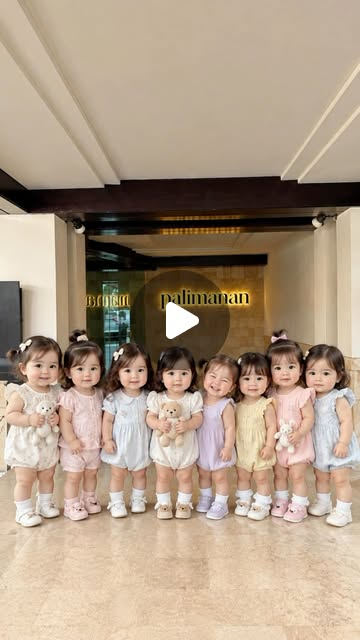

**Judul/topik:** Konten gambar AI (ChatGPT): bayi kembar banyak.

**Ringkasan:** Gambar AI berisi 8 balita perempuan kembar berpakaian pastel di lobi hotel bertuliskan "Palimanan". Caption menyiratkan kreator menyerahkan hasilnya ke ChatGPT ("suka suka ChatGPT aja"). 2,6K like.

**Poin penting:**
- Tren konten gambar AI yang lucu/imut.
- Hashtag: #chatGPT #konten #memes #wanitaindonesia.
- Engagement jauh lebih kecil dibanding konten berbasis kepribadian (#2, #10).

**Ide yang bisa diterapkan:**
- Konten AI mudah dibuat tetapi pasarnya sudah jenuh; tambahkan cerita atau unsur lokal agar menonjol.
- Beri label jelas bahwa konten dibuat dengan AI.

## 10. 김민수 (Kim Min Su) — "Makan camilan jam 3 pagi"
https://www.instagram.com/reel/Dfhx1gmSgJX/ · 9 Nov 2026

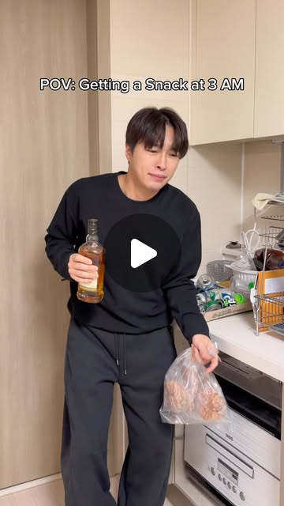

**Judul/topik:** Komedi POV: ngemil jam 3 pagi.

**Ringkasan:** Kreator Korea di dapur membawa botol minuman dan plastik camilan dengan teks "POV: Getting a Snack at 3 AM". *(dugaan)* Isinya akting mengendap-endap tanpa dialog. **2 juta like.**

**Poin penting:**
- Komedi tanpa kata (visual/gestur) bisa dipahami lintas negara dan bahasa.
- Format "POV:" + situasi universal sangat mudah relate.
- Teks di layar dalam bahasa Inggris, caption dalam bahasa Korea, sehingga menjangkau dua pasar.

**Ide yang bisa diterapkan:**
- Buat sketsa tanpa dialog untuk menjangkau audiens global.
- Angkat kebiasaan universal (begadang, ngemil, mager) sebagai bahan POV.

## 11. Rumpi Gosip — Plot twist chat "kode rahasia" anti-filter spam
https://www.instagram.com/p/Df8sWcwj396/ · 19 Nov 2026 · Foto

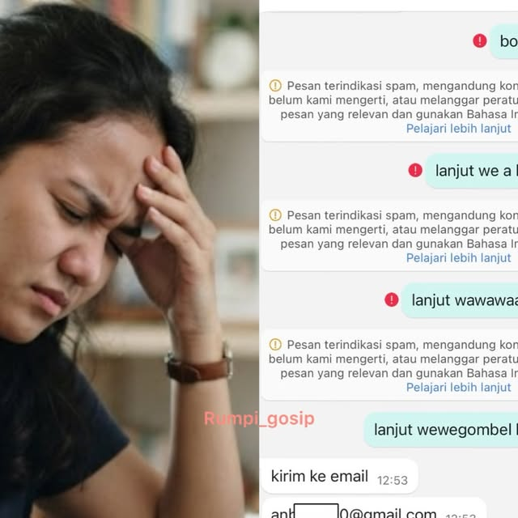

**Judul/topik:** Screenshot chat lucu: menghindari filter spam aplikasi.

**Ringkasan:** Kolase foto wanita pusing dan screenshot chat di aplikasi (kemungkinan marketplace atau ojol) yang terus kena peringatan "Pesan terindikasi spam". Pengirim mencoba menulis "WhatsApp" dengan plesetan seperti "we a", "wawawaa", "wewegombel", "wacap", "uaszap", hingga "uwakwaw", lalu akhirnya bertukar email. 16K like, 1,5K komentar.

**Poin penting:**
- Humor dari kreativitas netizen mengakali sistem.
- Akun gosip/kurasi tinggal mengemas ulang screenshot viral dengan caption storytelling ("kirain drama, ternyata...").
- Format "plot twist" mendorong orang membaca sampai habis dan berkomentar.

**Ide yang bisa diterapkan:**
- Gunakan struktur caption "Kirain X, ternyata Y".
- Jika kamu pelaku usaha di marketplace, ini pengingat bahwa platform memblokir ajakan bertransaksi di luar aplikasi.

## 12. M Aldo Giustino — "boong-boongin orang mulu kaya....."
https://www.instagram.com/reel/DgCZIoFPdCN/ · @aldogiustino · 22 Nov 2026

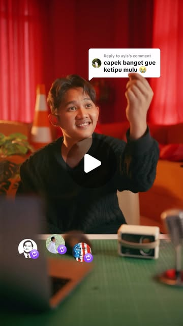

**Judul/topik:** Reel balasan komentar ("Reply to comment"), tentang orang yang suka bohong/PHP.

**Ringkasan:** Kreator duduk di meja studio rumahan (mikrofon, speaker, laptop, latar merah) sambil tersenyum dan membuat gestur tangan. Di layar ada stiker balasan komentar dari pengikut: "capek banget gue ketipu mulu 😮‍💨". Di bagian bawah ada beberapa ikon avatar (tokoh/figur) dengan simbol ulang. Caption menggantung: "boong-boongin orang mulu kaya.....". *(dugaan)* Isinya menyamakan "orang yang suka bohong" dengan sosok atau pihak tertentu, sebagai sindiran lucu, dengan punchline di akhir video. 68K like, 559 komentar (diunggah hari ini).

**Poin penting:**
- **Format reply-to-comment:** komentar penonton menjadi ide konten, sekaligus membuat penonton merasa didengar dan memancing lebih banyak komentar.
- **Caption menggantung ("kaya.....")** memaksa orang menonton sampai habis untuk tahu punchline-nya.
- Topik "capek ditipu/di-PHP" sangat relatable.
- Setting studio rumahan yang rapi dan berwarna kuat (merah) terlihat profesional tanpa biaya besar.
- Avatar tokoh di bawah layar mengarah ke sindiran sosial/politik, yang memancing debat di komentar tetapi berisiko kalau terlalu tajam.

**Ide yang bisa diterapkan:**
- Rutin pilih 1 komentar menarik per minggu lalu jawab dengan video ("Reply to @...").
- Pakai caption kalimat yang sengaja dipotong untuk menaikkan watch time.
- Bangun "set" konten tetap (warna latar, properti) supaya video mudah dikenali.
- Kalau menyindir tokoh publik, jaga nada tetap humor dan hindari tuduhan faktual.

---

## Insight umum dari 12 konten

1. **Relatable > produksi mahal.** Konten dengan like tertinggi (3 jt & 2 jt) adalah video wajah sederhana dengan situasi sehari-hari (chat ojol, ngemil tengah malam).
2. **Chat/screenshot/komentar adalah format emas.** 5 dari 12 konten (#2, #4, #5, #11, #12) berbasis chat atau balasan komentar.
3. **Brand lokal bisa viral lewat meme.** Mie Soobek muncul 4 kali dengan engagement 110K–524K tanpa hard-selling, memakai bahasa Sunda dan konteks Bandung.
4. **Caption pendek + hook visual kuat** sudah cukup; teks di layar lebih penting daripada caption.
5. **Seri menurun kalau formatnya tidak divariasikan** (#2 → #5).
6. **Konten AI murni engagement-nya rendah** dibanding konten berbasis kepribadian.
7. **Untuk jualan (#1):** gunakan storytelling perbandingan, daftar manfaat, harga coret, garansi, dan CTA "komen KATA".

## Rencana aksi yang disarankan

- [ ] Buat 1 seri konten berbasis chat/screenshot sesuai niche sendiri (kumpulkan dari audiens).
- [ ] Uji 3 hook teks di layar pada detik pertama.
- [ ] Buat 1 sketsa tanpa dialog bertema kebiasaan universal.
- [ ] Untuk konten jualan, pakai struktur: cerita perbandingan → daftar manfaat → penawaran → garansi → CTA komen.
- [ ] Sisipkan identitas lokal (bahasa/daerah) bila target pasarnya lokal.
